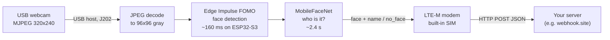

# F1 FaceCam

**A cellular camera that finds and recognises faces entirely on the SG Wireless F1 Starter Kit, with models built in Edge Impulse.**

You plug a USB webcam into the F1. An Edge Impulse model looks for faces on the board itself, and a second one
tells who it is. When someone shows up (or leaves), the F1 sends a small JSON message over LTE-M.
It needs no Wi-Fi, no gateway and no cloud AI. Images stay on the device.

Both models come with this repository, ready to build. The F1 learns new people on the board: register someone from
your phone, and 15 seconds later it knows them. No training in the cloud, no account needed.

The F1 also opens its own Wi-Fi network with a **live preview**. Join it with your phone to watch the camera with
names on the faces, and to register people.



A message looks like this:

```json
{"device":"f1","event":"face","name":"Ada","similarity":0.71,"confidence":0.97,"faces":1,"inference_ms":157,"uptime_s":412,"csq":27}
```

## Why these two work well together

| | SG Wireless F1 Starter Kit | Edge Impulse |
|---|---|---|
| **Role** | Runs both models, learns people, sends the result | Built and packaged the models |
| **Strengths used here** | ESP32-S3 with AI vector instructions, 8 MB PSRAM for a 1 MB recognition model, 16 MB flash, USB-C host port for a webcam, Wi-Fi for the phone page, LTE-M modem with a SIM already on board | FOMO object detection made for microcontrollers, int8 quantisation, EON Compiler, **Bring your own model**, one-click C++ export |
| **Result** | A camera that works anywhere with mobile coverage and learns faces on the spot | A 30 KB face finder trained in Studio, plus an imported 1 MB face recogniser, both as the same C++ library |

Edge Impulse turned a folder of photos (and a model from elsewhere) into a small, fast C++ library. The F1 gives that
library a camera, enough memory and its own internet connection, and learns the people you show it.

Both Edge Impulse projects are public, so you can see exactly how the models were made: the labelled photos,
the pipeline, the accuracy and the on-device estimates, without an account.

| Model | Public Edge Impulse project |
|---|---|
| Face finder (FOMO, trained in Studio) | [F1 face detection - FOMO](https://studio.edgeimpulse.com/public/1161327/latest) |
| Face recogniser (MobileFaceNet, Bring your own model) | [F1 face recognition - MobileFaceNet](https://studio.edgeimpulse.com/public/1161859/latest) |

## Measured on the board

| | |
|---|---|
| Face finder (FOMO) | **~157 ms** per frame (ESP-NN optimised kernels), 29 KB flash, 146 KB working memory |
| Full loop (camera, decode, finder) | **~3.7 frames per second** |
| Finder accuracy | F1 score **89%** on the validation set |
| Face recogniser (MobileFaceNet) | **~2.4 s** per face, 1.1 MB flash, 686 KB working memory (PSRAM), once per visit |
| Recogniser accuracy | right person for 88 to 90 of 90 test photos (30 people from LFW) |
| Registering a person | 5 pictures, **~15 s**, on the board |
| Power-on to first message | **~15 s** (LTE-M attach and send included) |
| Firmware | 2.5 MB of a 6 MB slot; about 130 KB internal RAM free with everything on |

## Quick start

You need an **SG Wireless F1 Starter Kit**, a **USB webcam** that does MJPEG (most do) and a USB-C cable.

1. **Choose where messages go.** Open [webhook.site](https://webhook.site), copy your URL and create
   `sdkconfig.defaults.local`. Also pick your own Wi-Fi password for the preview (at least 8 characters;
   without it, the password is `f1-facecam`):
   ```
   CONFIG_APP_PUBLISH_URL="http://webhook.site/<your-id>"
   CONFIG_APP_PREVIEW_PASSWORD="choose-a-password"
   ```
2. **Build and flash.** Connect the top USB-C port (J201) and run `pio run -t upload -t monitor`.
   Flashing erases the whole board first, so every flash starts from scratch.
3. **Plug in the webcam** on the bottom USB-C port (J202) and look into it. The LED turns magenta, and a `face` event appears on webhook.site.
4. **Register yourself.** Join the Wi-Fi network `F1-FaceCam`, open `http://192.168.4.1`, type your name and press
   **Register**. The LED turns cyan when the F1 sees you, and events carry your name.
   See [Face recognition](docs/face-recognition.md).

Step-by-step instructions, the expected output and troubleshooting are in [Deploy to the F1](docs/deploy-to-f1.md).

## Learn more

| Guide | What's inside |
|---|---|
| [Deploy to the F1](docs/deploy-to-f1.md) | Build, flash, live preview, troubleshooting |
| [Face recognition](docs/face-recognition.md) | How the F1 learns and recognises people, registering from your phone |
| [How it works](docs/how-it-works.md) | The code, one stage at a time, the F1-specific tricks, and where the models come from |
| [Pin map](docs/pinmap.md) | Every F1 pin this project uses, with its source |

## Project layout

```
src/main.cpp              the app: camera -> models -> event, status LED, heartbeat
components/camera/        USB webcam -> 96x96 grayscale image (+ colour face crops)
components/inference/     runs the two models (Edge Impulse exports in ei/ and ei-face-id/)
components/people/        registered people: names + face fingerprints in flash
components/preview/       Wi-Fi page: live view, register people
components/lte/           LTE-M connection and HTTP messages
components/usb_host_uvc/  Espressif's webcam driver with a small F1 patch
```

## Notes

- **Privacy:** frames exist only in RAM and are overwritten by the next one. Only the result (and a name) goes over LTE.
  The live preview sends frames to the browser on the F1's own password-protected Wi-Fi network, and nowhere else.
  Change the default Wi-Fi password, or turn the preview off with `CONFIG_APP_PREVIEW=n`. Face fingerprints of registered people stay in the F1's flash until you delete them or flash
  the board again. Face recognition is biometric processing: tell people, and ask before you register them.
- **Licences:** the face finder was trained on Edge Impulse's public face project, built on FFHQ images licensed
  CC BY-NC-SA 4.0 (non-commercial); for a product, train on data you have the rights to. MobileFaceNet: Apache-2.0 (NXP).
  Edge Impulse SDK: see `components/inference/ei/edge-impulse-sdk/LICENSE*`.
- **Plain HTTP:** messages are sent unencrypted to keep the demo simple. Use HTTPS or MQTT over TLS for real deployments.
