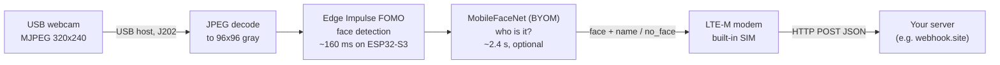

# F1 FaceCam

**A cellular camera that finds and recognises faces entirely on the SG Wireless F1 Starter Kit, with models built in Edge Impulse.**

You plug a USB webcam into the F1. An Edge Impulse model looks for faces on the board itself, and a second one
tells who it is. When someone shows up (or leaves), the F1 sends a small JSON message over LTE-M.
It needs no Wi-Fi, no gateway and no cloud AI. Images stay on the device.

Optional: turn on the **live preview**. The F1 opens its own Wi-Fi network. Join it with your phone to watch the
camera with names on the faces, register people, collect training images for Edge Impulse and install new firmware.



A message looks like this:

```json
{"device":"f1","event":"face","name":"Ada","similarity":0.71,"confidence":0.97,"faces":1,"inference_ms":157,"uptime_s":412,"csq":27}
```

## Why these two work well together

| | SG Wireless F1 Starter Kit | Edge Impulse |
|---|---|---|
| **Role** | Runs both models and sends the result | Builds and packages the models |
| **Strengths used here** | ESP32-S3 with AI vector instructions, 8 MB PSRAM for a 1 MB recognition model, 16 MB flash with two firmware slots, USB-C host port for a webcam, Wi-Fi for the phone page, LTE-M modem with a SIM already on board | Dataset labelling, FOMO object detection made for microcontrollers, int8 quantisation, EON Compiler, **Bring your own model**, one-click C++ export |
| **Result** | A camera that works anywhere with mobile coverage and updates over the air | A 30 KB face finder trained in Studio, plus an imported 1 MB face recogniser, both as the same C++ library |

Edge Impulse turns a folder of photos (or a model from elsewhere) into a small, fast C++ library. The F1 gives that
library a camera, enough memory and its own internet connection. The loop closes on the device itself: collect
images from the F1's page, retrain in Studio, and upload the new firmware from the same page.

## Measured on the board

| | |
|---|---|
| Face finder (FOMO) | **~157 ms** per frame (ESP-NN optimised kernels), 29 KB flash, 146 KB working memory |
| Full loop (camera, decode, finder) | **~3.7 frames per second** |
| Finder accuracy | F1 score **89%** on the validation set |
| Face recogniser (MobileFaceNet) | **~2.4 s** per face, 1.1 MB flash, 686 KB working memory (PSRAM), once per visit |
| Recogniser accuracy | right person for 88 to 90 of 90 test photos (30 people from LFW) |
| Power-on to first message | **~15 s** (LTE-M attach and send included) |
| Firmware | 2.5 MB of a 4 MB slot; about 130 KB internal RAM free with everything on |

## Quick start

You need an **SG Wireless F1 Starter Kit**, a **USB webcam** that does MJPEG (most do) and a USB-C cable.

1. **Train a model.** Clone the public face project in Edge Impulse, set it to grayscale, train and export it as a C++ library.
   See [Train your model](docs/train-your-model.md).
2. **Add the model.** Unzip the export into [components/inference/ei/](components/inference/ei/).
3. **Choose where messages go.** Open [webhook.site](https://webhook.site), copy your URL and create `sdkconfig.defaults.local`:
   ```
   CONFIG_APP_PUBLISH_URL="http://webhook.site/<your-id>"
   ```
4. **Build and flash.** Connect the top USB-C port (J201) and run `pio run -t upload -t monitor`.
5. **Plug in the webcam** on the bottom USB-C port (J202) and look into it. The LED turns magenta, and a `face` event appears on webhook.site.
6. **Optional, live preview:** add these lines to `sdkconfig.defaults.local`, flash again, join the Wi-Fi network
   `F1-FaceCam` and open `http://192.168.4.1`:
   ```
   CONFIG_APP_PREVIEW=y
   CONFIG_APP_PREVIEW_PASSWORD="at-least-8-chars"
   ```
7. **Optional, recognise people:** bring MobileFaceNet into Edge Impulse, export it into
   `components/inference/ei-face-id/`, flash, and register people on the preview page.
   See [Face recognition](docs/face-recognition.md).

Step-by-step instructions, the expected output and troubleshooting are in [Deploy to the F1](docs/deploy-to-f1.md).

## Learn more

| Guide | What's inside |
|---|---|
| [Train your model](docs/train-your-model.md) | Edge Impulse Studio walkthrough with screenshots |
| [Deploy to the F1](docs/deploy-to-f1.md) | Build, flash, live preview, updates over Wi-Fi, troubleshooting |
| [Face recognition](docs/face-recognition.md) | Bring your own model into Edge Impulse, register people from your phone |
| [How it works](docs/how-it-works.md) | The code, one stage at a time, and the F1-specific tricks |
| [Pin map](docs/pinmap.md) | Every F1 pin this project uses, with its source |

## Project layout

```
src/main.cpp              the app: camera -> models -> event, status LED, heartbeat
components/camera/        USB webcam -> 96x96 grayscale image (+ colour face crops)
components/inference/     runs the Edge Impulse models (exports go in ei/ and ei-face-id/)
components/people/        registered people: names + face fingerprints in flash
components/preview/       optional Wi-Fi page: live view, people, image collection, firmware update
components/lte/           LTE-M connection and HTTP messages
components/usb_host_uvc/  Espressif's webcam driver with a small F1 patch
```

## Notes

- **Privacy:** frames exist only in RAM and are overwritten by the next one. Only the result (and a name) goes over LTE.
  The live preview (off by default) sends frames to the browser on the F1's own password-protected Wi-Fi network,
  and nowhere else. Face fingerprints of registered people stay in the F1's flash. Face recognition is biometric
  processing: tell people, and ask before you register them.
- **Licences:** the public face project is built on FFHQ images, licensed CC BY-NC-SA 4.0
  (non-commercial); for a product, train on data you have the rights to. MobileFaceNet: Apache-2.0 (NXP).
- **Plain HTTP:** messages are sent unencrypted to keep the demo simple. Use HTTPS or MQTT over TLS for real deployments.
  Anyone who knows the preview Wi-Fi password can also install firmware from the page.
