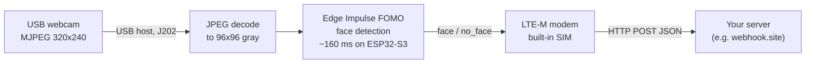

# F1 FaceCam

**A cellular face detector that runs entirely on the SG Wireless F1 Starter Kit, using a model trained with Edge Impulse.**

You plug a USB webcam into the F1. An Edge Impulse model looks for faces on the board itself.
When someone shows up (or leaves), the F1 sends a small JSON message over LTE-M.
It needs no Wi-Fi, no gateway and no cloud AI. Images stay on the device.

Optional: turn on the **live preview**. The F1 opens its own Wi-Fi network; join it with your phone and
watch the camera with the detected faces drawn on top.



A message looks like this:

```json
{"device":"f1","event":"face","confidence":0.97,"faces":1,"inference_ms":157,"uptime_s":412,"csq":27}
```

## Why these two work well together

| | SG Wireless F1 Starter Kit | Edge Impulse |
|---|---|---|
| **Role** | Runs the model and sends the result | Builds the model |
| **Strengths used here** | ESP32-S3 with AI vector instructions, 8 MB PSRAM, USB-C host port for a webcam, LTE-M modem with a SIM already on board | Dataset labelling, FOMO object detection made for microcontrollers, int8 quantisation, EON Compiler, one-click C++ export |
| **Result** | A camera that works anywhere with mobile coverage | A 30 KB face model that runs about 6 times per second |

Edge Impulse turns a folder of photos into a small, fast C++ library. The F1 gives that library a camera,
enough memory and its own internet connection. Together they make a working edge-AI device in an afternoon.

## Measured on the board

| | |
|---|---|
| Model run time | **~157 ms** per frame (ESP-NN optimised kernels) |
| Full loop (camera, decode, model) | **~3.7 frames per second** |
| Model size | 29 KB flash, 146 KB working memory (in PSRAM) |
| Model accuracy | F1 score **89%** on the validation set |
| Power-on to first message | **~15 s** (LTE-M attach and send included) |
| Firmware | 0.85 MB of 8 MB, 245 KB internal RAM left free (1.2 MB and 143 KB with the Wi-Fi preview on) |

## Quick start

You need an **SG Wireless F1 Starter Kit**, a **USB webcam** that does MJPEG (most do) and a USB-C cable.

1. **Train a model.** Clone the public face project in Edge Impulse, set it to grayscale, train and export it as a C++ library.
   See [Train your model](docs/train-your-model.md).
2. **Add the model.** Unzip the export into [components/inference/ei/](components/inference/ei/).
3. **Choose where messages go.** Open [webhook.site](https://webhook.site), copy your URL and create `sdkconfig.defaults.local`:
   ```
   CONFIG_APP_PUBLISH_URL="http://webhook.site/<your-id>"
   ```
4. **Build and flash.** Connect the top USB-C port (J201) and run `pio run -t upload -t monitor`.
5. **Plug in the webcam** on the bottom USB-C port (J202) and look into it. The LED turns magenta, and a `face` event appears on webhook.site.
6. **Optional, live preview:** add these lines to `sdkconfig.defaults.local`, flash again, join the Wi-Fi network
   `F1-FaceCam` and open `http://192.168.4.1`:
   ```
   CONFIG_APP_PREVIEW=y
   CONFIG_APP_PREVIEW_PASSWORD="at-least-8-chars"
   ```

Step-by-step instructions, the expected output and troubleshooting are in [Deploy to the F1](docs/deploy-to-f1.md).

## Learn more

| Guide | What's inside |
|---|---|
| [Train your model](docs/train-your-model.md) | Edge Impulse Studio walkthrough with screenshots |
| [Deploy to the F1](docs/deploy-to-f1.md) | Build, flash, what you should see, troubleshooting |
| [How it works](docs/how-it-works.md) | The code, one stage at a time, and the F1-specific tricks |
| [Pin map](docs/pinmap.md) | Every F1 pin this project uses, with its source |

## Project layout

```
src/main.cpp              the app: camera -> model -> event, status LED, heartbeat
components/camera/        USB webcam -> 96x96 grayscale image
components/inference/     runs the Edge Impulse model (export goes in ei/)
components/lte/           LTE-M connection and HTTP messages
components/usb_host_uvc/  Espressif's webcam driver with a small F1 patch
```

## Notes

- **Privacy:** frames exist only in RAM and are overwritten by the next one. Only the result goes over LTE.
  The live preview (off by default) sends frames to the browser on the F1's own password-protected Wi-Fi network, and nowhere else.
- **Dataset licence:** the public face project is built on FFHQ images, licensed CC BY-NC-SA 4.0
  (non-commercial). For a product, train on data you have the rights to.
- **Plain HTTP:** messages are sent unencrypted to keep the demo simple. Use HTTPS or MQTT over TLS for real deployments.
