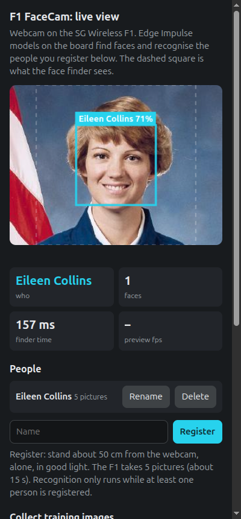
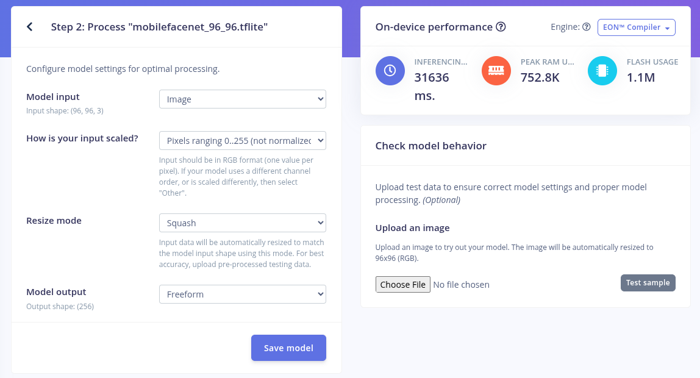

# Face recognition: who is it?

The face finder (FOMO) tells *where* a face is. A second Edge Impulse model tells *who* it is.
You register people from your phone on the live preview page. There is no retraining and no cloud,
and the F1 keeps the list in its own flash.



*The preview page on a phone: a registered person in cyan with the match score, the people list below.
The photo is a public-domain NASA portrait of Eileen Collins.*

## How it works

1. FOMO finds the faces in the 96x96 grayscale image, as before (~160 ms).
2. The F1 cuts the best face out of the full-resolution colour frame and shrinks it to 96x96.
3. **MobileFaceNet** turns that picture into a *fingerprint*: 256 numbers. Two pictures of the same person
   give similar fingerprints, two different people don't (~2.4 s on the ESP32-S3).
4. The F1 compares it with the fingerprints of everyone registered. If the best match scores at least
   **0.45** (`face_id::kMatch`), that's who it is; otherwise "unknown".

Registering someone takes 5 pictures and stores their average fingerprint, so no model is trained on the
device or in the cloud. Adding a person takes about 15 seconds.

Recognition runs when a face appears and then every 10 s while it stays, and only once somebody is registered.
LTE events then carry the name:

```json
{"device":"f1","event":"face","name":"Eileen Collins","similarity":0.63,"confidence":0.87,"faces":1,"inference_ms":161,"uptime_s":33,"csq":26}
```

## 1. Bring the model into Edge Impulse

Edge Impulse's **Bring your own model** (BYOM) takes a model trained elsewhere, profiles it for your device and
exports it as the same kind of C++ library as a model trained in Studio. It works on the free plan.

The model is NXP's int8 [MobileFaceNet](https://huggingface.co/nxp/mobilefacenet-imx) (Apache-2.0, 1 MB,
96x96 colour input, 256-number output). Download `mobilefacenet_96_96.tflite` from
`assets/quantized_tflite_model_mcu/` in that repository.

1. Create a new project and choose **Upload your model** on the dashboard.
2. Upload `mobilefacenet_96_96.tflite`. Under *Model performance* pick a device for profiling
   (ESP-EYE is the closest ESP32 in the list).
3. Set the model settings and click **Save model**:

| Setting | Value |
|---|---|
| Model input | **Image** |
| How is your input scaled? | **Pixels ranging 0..255 (not normalized)** (the model normalises inside) |
| Model output | **Freeform** (a fingerprint is neither a class nor a box) |



*Edge Impulse profiles the model right away: 1.1 MB flash and 753 KB RAM. Its 32 s time estimate is for the original
ESP32 without vector instructions. The F1's ESP32-S3 with ESP-NN does it in 2.4 s.*

## 2. Export it

Open **Deployment**, choose **C++ library** and **Build**. On the free plan an uploaded model runs on
**TensorFlow Lite** (the EON Compiler is for models trained in Studio). That's fine: the F1 has the PSRAM for it.


Unzip the export into `components/inference/ei-face-id/`, next to the face finder in `ei/`:

```
components/inference/
├── ei/            face finder (FOMO), trained in Edge Impulse
└── ei-face-id/    face recognition (MobileFaceNet), brought into Edge Impulse
```

Build and flash as usual. The build log says `Face recognition model: .../tflite_learn_*.tflite`. Without
`ei-face-id/`, the firmware builds as a plain face detector.

## 3. Check it on the board

At boot the F1 tests the model on public-domain NASA portraits. Eileen Collins must match another photo of herself,
and nobody else:

```
I (7534) inference: self-test Eileen Collins (other photo) PASS  (similarity to Collins 0.75, 2353 ms)
I (9908) inference: self-test Neil Armstrong               PASS  (similarity to Collins 0.02, 2357 ms)
I (12286) inference: self-test Sally Ride                   PASS  (similarity to Collins 0.26, 2361 ms)
```

## 4. Register people

Turn on the [live preview](deploy-to-f1.md#6-optional-live-preview-on-your-phone), join the F1's Wi-Fi, open
`http://192.168.4.1`, type a name and press **Register**. Stand alone, about 50 cm from the webcam, in good light,
and move your head a little between the 5 pictures. Registering the same name again adds more pictures to that person.
**Rename** and **Delete** are next to each name.

| LED | Meaning |
|---|---|
| Cyan | Someone you registered |
| Magenta | A face, unknown or not checked yet |

## Good to know

- **Distance matters.** FOMO finds face centres, not sizes, so the F1 always cuts out the same square (half the image
  height). Register at the distance people will usually stand from the camera.
- **One face at a time.** Only the best face is recognised. Other faces are still counted.
- **Accuracy.** On 30 people from the LFW benchmark, 88 to 90 of 90 test photos were matched to the right person.
  That's good enough for a demo or a welcome screen, but **not for security** (a photo can fool it).
- **Privacy.** Fingerprints are biometric data. They stay in the F1's `people` flash partition and never go over LTE,
  only the name does. `Delete` removes them.
- **Licences.** MobileFaceNet: Apache-2.0 (NXP) / MIT (original). Test portraits: NASA, public domain.
