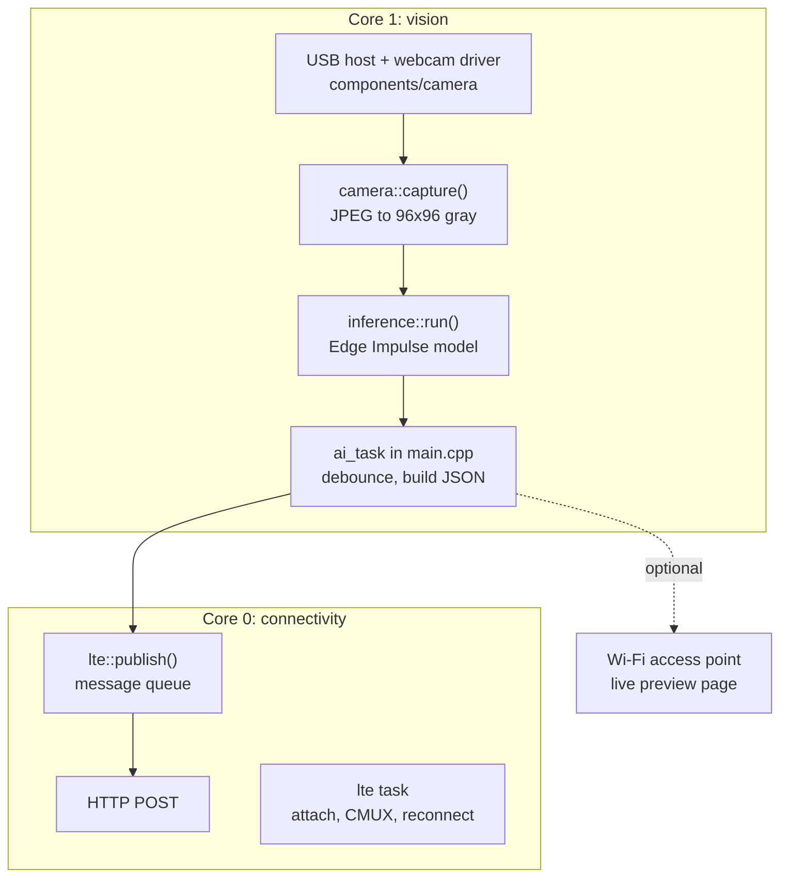

# How it works

The firmware is under 1,000 lines of C++ on top of ESP-IDF, in four parts plus an optional live preview. Each one does a single job.

The ESP32-S3 has two cores. The camera and model run on one, so the cellular link on the other never waits for them.

## 1. Camera: [components/camera](../components/camera/camera.cpp)

- The bottom USB-C port (J202) runs as a **USB host**. Espressif's `usb_host_uvc` driver talks to any standard (UVC) webcam.
- We ask for **MJPEG** close to 320x240. The camera compresses each frame, so it fits through Full-Speed USB.
- The USB callback copies a frame into a buffer only when the previous one has been used. A slow consumer simply
  skips frames; nothing ever queues up.
- `camera::capture()` decodes the JPEG with `esp_jpeg` and asks the decoder to shrink the image while decoding
  (1/2 here, which is much faster). It then centre-crops to a square, averages pixels down to 96x96 and converts to grayscale.
- Unplugging and replugging the camera is handled without a reboot.

## 2. Model: [components/inference](../components/inference/inference.cpp)

- `inference::run()` hands the 96x96 image to Edge Impulse's `run_classifier()` and returns the best face's
  score and position.
- The SDK reads pixels as packed `0xRRGGBB` values. With R = G = B it calculates exactly our gray value again.
- [CMakeLists.txt](../components/inference/CMakeLists.txt) builds the exported library with **ESP-NN**,
  Espressif's neural-network kernels that use the S3's vector instructions.
- `self_test()` runs the model on three built-in photos at boot ([tools/make_test_images.py](../tools/make_test_images.py)),
  so a model problem shows up before any camera is plugged in.

## 3. LTE-M: [components/lte](../components/lte/lte.cpp)

- The **Sequans GM02S** modem sits on UART1. Its power and reset lines go through an I2C IO expander
  ([modem_power.cpp](../components/lte/modem_power.cpp)).
- Connecting is three steps: reset the modem, attach with the APN (`AT+CFUN`, `AT+CGDCONT`, wait for `AT+CEREG`),
  then start **CMUX**. CMUX splits the one UART into two virtual channels: PPP data for the internet, and AT commands
  so we can keep reading the signal strength while online.
- Every 30 s the task checks the signal. If the IP is lost or the modem stops answering, it reconnects from scratch.
- `lte::publish()` only puts a copy of the message in a queue. A separate task sends it as an HTTP POST, with 3 tries.
  So the camera loop never waits for the network.

## 4. The app: [src/main.cpp](../src/main.cpp)

- `ai_task` loops: capture, run the model, log the result.
- It sends an event only when the answer changes (face to no face, or back) for **2 frames in a row**, and at most every
  **10 s**. This stops one blurry frame from causing a message.
- The main loop drives the status LED and sends a `boot` message, then a `heartbeat` every 5 minutes.

## 5. Live preview (optional): [components/preview](../components/preview/preview.cpp)

- The F1 starts a Wi-Fi **access point** (WPA2) and a small **web server** on core 0.
- The page ([index.html](../components/preview/index.html), built into the firmware) asks for `/frame.jpg` again and again.
  Each answer is the newest webcam JPEG, sent exactly as the camera made it: the F1 never re-encodes an image.
- The latest detections go along in an `X-Detections` HTTP header, for example
  `{"size":96,"ms":157,"faces":[[40,32,8,8,0.97]]}`. The page draws the boxes on a canvas over the image,
  mapped back from the model's 96x96 square onto the camera frame.
- FOMO finds face *centres*, so the page draws a fixed-size square around each one.
- Cost on the board: about 100 KB of internal RAM (143 KB stays free) and 0.4 MB of flash. The model speed is unchanged.

## F1-specific details worth knowing

These took real debugging on the board. They are all in the code, with comments.

| Topic | What we found |
|---|---|
| **Webcam packet size** | The S3's USB FIFO holds 800 bytes in total. The default split lets video packets be at most 596 bytes, but most webcams want 700 or more. Since video only flows *in*, we move the unused periodic-OUT share to RX ([camera.cpp](../components/camera/camera.cpp) `usb_host_task`) and raise the driver's limit to 724 bytes ([F1 PATCH](../components/usb_host_uvc/private_include/uvc_idf_version_priv.h)). |
| **16-byte alignment** | ESP-NN's vector stores ignore the low 4 address bits. Every buffer the model writes to must be 16-byte aligned, or it silently corrupts the heap. We override `ei_malloc`/`ei_calloc` for this ([inference.cpp](../components/inference/inference.cpp)). |
| **Model memory in PSRAM** | The 146 KB tensor arena goes to the 8 MB PSRAM. That keeps about 245 KB of fast internal RAM free for USB and LTE. Inference still takes only about 157 ms. |
| **APN** | The kit's 1NCE SIM attaches with `iot.1nce.net`. |
| **Modem power** | GM02S power and reset are pins P1 and P3 of a PCAL6408A expander at I2C address 0x21, not ESP32 GPIOs ([pin map](pinmap.md)). |

## Where to go next

- **Recognise *who* it is:** add a second model that computes a face embedding, and compare it on the device.
- **Secure transport:** switch `http://` to `https://` (the ESP-IDF HTTP client supports TLS), or use MQTT.
- **Run on battery:** the F1 has a fuel gauge and LTE-M power saving (PSM), so the modem can sleep between events.
