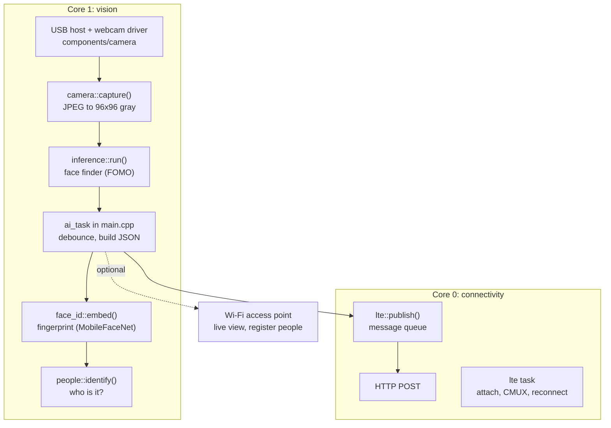

# How it works

The firmware is about 1,700 lines of C++ on top of ESP-IDF (plus one web page), in small parts that each do a single job.

The ESP32-S3 has two cores. The camera and model run on one, so the cellular link on the other never waits for them.

## 1. Camera: [components/camera](../components/camera/camera.cpp)

- The bottom USB-C port (J202) runs as a **USB host**. Espressif's `usb_host_uvc` driver talks to any standard (UVC) webcam.
- We ask for **MJPEG** close to 320x240. The camera compresses each frame, so it fits through Full-Speed USB.
- The USB callback copies a frame into a buffer only when the previous one has been used. A slow consumer simply
  skips frames; nothing ever queues up.
- `camera::capture()` decodes the JPEG with `esp_jpeg` and asks the decoder to shrink the image while decoding
  (1/2 here, which is much faster). It then centre-crops to a square, averages pixels down to 96x96 and converts to grayscale.
- Unplugging and replugging the camera is handled without a reboot.

## 2. Face finder: [components/inference](../components/inference/inference.cpp)

- `inference::run()` hands the 96x96 image to Edge Impulse's `run_classifier()` and returns the best face's
  score and position.
- The SDK reads pixels as packed `0xRRGGBB` values. With R = G = B it calculates exactly our gray value again.
- [CMakeLists.txt](../components/inference/CMakeLists.txt) builds the Edge Impulse export in `ei/` with **ESP-NN**,
  Espressif's neural-network kernels that use the S3's vector instructions.
- `self_test()` runs the models on built-in photos at boot ([tools/make_test_images.py](../tools/make_test_images.py)),
  so a model problem shows up before any camera is plugged in.

## 3. Recognition: [face_id.cpp](../components/inference/face_id.cpp) and [components/people](../components/people/people.cpp)

- The second model, MobileFaceNet, is in `ei-face-id/`. The build links its `.tflite` file into the firmware and
  reuses the SDK of the first export.
- One firmware can only hold one `run_classifier()` model, so `face_id.cpp` gives this one straight to the SDK's
  TensorFlow Lite Micro interpreter, with the operator list Edge Impulse generated for it.
- `camera::crop_face()` decodes the same frame again at full size and cuts out a square around the face centre.
- `people` keeps names and fingerprints in RAM and in the `people` flash partition. Matching is a dot product per person.
- Learning a person is on-board training without changing the model: average the fingerprints of 5 pictures.
- The partition also stores the ELF hash of the firmware that wrote it. A different firmware wipes it on first boot,
  so a newly flashed F1 always starts empty, whatever tool flashed it. `pio run -t upload` erases the whole chip anyway
  ([tools/erase_on_upload.py](../tools/erase_on_upload.py)).

## 4. LTE-M: [components/lte](../components/lte/lte.cpp)

- The **Sequans GM02S** modem sits on UART1. Its power and reset lines go through an I2C IO expander
  ([modem_power.cpp](../components/lte/modem_power.cpp)).
- Connecting is three steps: reset the modem, attach with the APN (`AT+CFUN`, `AT+CGDCONT`, wait for `AT+CEREG`),
  then start **CMUX**. CMUX splits the one UART into two virtual channels: PPP data for the internet, and AT commands
  so we can keep reading the signal strength while online.
- Every 30 s the task checks the signal. If the IP is lost or the modem stops answering, it reconnects from scratch.
- `lte::publish()` only puts a copy of the message in a queue. A separate task sends it as an HTTP POST, with 3 tries.
  So the camera loop never waits for the network.

## 5. The app: [src/main.cpp](../src/main.cpp)

- `ai_task` loops: capture, find faces, log the result.
- When a face appears (and every 10 s while it stays), it works out who it is, if anyone is registered.
  While someone registers on the page, it takes their 5 pictures instead.
- It sends an event only when the answer changes (face to no face, or back) for **2 frames in a row**, or the
  recognised person changes, and at most every **10 s**. This stops one blurry frame from causing a message.
- The main loop drives the status LED and sends a `boot` message, then a `heartbeat` every 5 minutes.

## 6. Live preview (optional): [components/preview](../components/preview/preview.cpp)

- The F1 starts a Wi-Fi **access point** (WPA2) and a small **web server** on core 0.
- The page ([index.html](../components/preview/index.html), built into the firmware) asks for `/frame.jpg` again and again.
  Each answer is the newest webcam JPEG, sent exactly as the camera made it: the F1 never re-encodes an image.
- The latest detections go along in an `X-Detections` HTTP header, for example
  `{"size":96,"ms":157,"faces":[[40,32,8,8,0.97]]}`. The page draws the boxes on a canvas over the image,
  mapped back from the model's 96x96 square onto the camera frame.
- FOMO finds face *centres*, so the page draws a fixed-size square around each one: the same square the F1 cuts
  out for recognition.
- `/people/...` lists, registers, renames and deletes people.

## F1-specific details worth knowing

These took real debugging on the board. They are all in the code, with comments.

| Topic | What we found |
|---|---|
| **Webcam packet size** | The S3's USB FIFO holds 800 bytes in total. The default split lets video packets be at most 596 bytes, but most webcams want 700 or more. Since video only flows *in*, we move the unused periodic-OUT share to RX ([camera.cpp](../components/camera/camera.cpp) `usb_host_task`) and raise the driver's limit to 724 bytes ([F1 PATCH](../components/usb_host_uvc/private_include/uvc_idf_version_priv.h)). |
| **16-byte alignment** | ESP-NN's vector stores ignore the low 4 address bits. Every buffer the model writes to must be 16-byte aligned, or it silently corrupts the heap. We override `ei_malloc`/`ei_calloc` for this ([inference.cpp](../components/inference/inference.cpp)). |
| **Model memory in PSRAM** | The 146 KB tensor arena goes to the 8 MB PSRAM. That keeps fast internal RAM free for USB, Wi-Fi and LTE. Inference still takes only about 157 ms. |
| **Two exports, one SDK** | Each export lists the kernels its model doesn't need (`trained_model_ops_define.h`) to save flash. The face finder's list switches off int8 `FULLY_CONNECTED`, which MobileFaceNet needs, and the model then fails silently. With both models, an empty list from [all-ops/](../components/inference/all-ops/tflite-model/trained_model_ops_define.h) keeps every kernel. |
| **Weights in PSRAM** | The F1's flash runs at DIO 40 MHz (SG Wireless's setting). MobileFaceNet reads all 1.1 MB of weights per face, so we copy them once into PSRAM (quad, 80 MHz): 3.8 s → 2.9 s. |
| **Faster PReLU** | MobileFaceNet has 33 PReLU layers, and the SDK only has the generic version (1.1 s per face). [fast_prelu.cpp](../components/inference/fast_prelu.cpp) gives the same results in half the time: 2.9 s → 2.4 s. |
| **APN** | The kit's 1NCE SIM attaches with `iot.1nce.net`. |
| **Modem power** | GM02S power and reset are pins P1 and P3 of a PCAL6408A expander at I2C address 0x21, not ESP32 GPIOs ([pin map](pinmap.md)). |

## Where the models come from

Both models are Edge Impulse C++ library exports, checked into [components/inference](../components/inference/).
You don't need Edge Impulse to build or use this project; this is how they were made. Both projects are public:
open them to look at the data, the impulse and the results, or click **Clone this project** to experiment.

| | Face finder | Face recogniser |
|---|---|---|
| Edge Impulse project | [F1 face detection - FOMO](https://studio.edgeimpulse.com/public/1161327/latest) | [F1 face recognition - MobileFaceNet](https://studio.edgeimpulse.com/public/1161859/latest) |
| Folder | `ei/` (whole export, with the SDK) | `ei-face-id/tflite-model/` (only the model) |
| Model | FOMO MobileNetV2 0.35, 96x96 grayscale, int8, EON Compiler | NXP's int8 [MobileFaceNet](https://huggingface.co/nxp/mobilefacenet-imx), 96x96 colour in, 256 numbers out |
| How | Trained in Edge Impulse Studio on a clone of the public [Face detection - FOMO](https://studio.edgeimpulse.com/public/87291/latest) project (70 cycles, learning rate 0.001, augmentation on) | Imported with **Bring your own model** (input: image, pixels 0..255; output: freeform), runs on TensorFlow Lite Micro |
| Size | 29 KB flash, 146 KB RAM | 1.1 MB flash, 686 KB RAM |

> **What is FOMO?** *Faster Objects, More Objects* is Edge Impulse's object detection model for microcontrollers.
> It doesn't draw full bounding boxes. It finds the *centre* of each object on a coarse grid, which makes it
> tiny and fast enough for the ESP32-S3.

## Where to go next

- **A finder that knows face sizes:** FOMO gives centres only, so recognition uses a fixed crop. A detector with real
  boxes (and eye positions to straighten the face) would make recognition work at any distance.
- **Faster recognition:** the remaining time is mostly convolutions on PSRAM data; a smaller input or a pruned model
  would help.
- **Secure transport:** switch `http://` to `https://` (the ESP-IDF HTTP client supports TLS), or use MQTT.
- **Run on battery:** the F1 has a fuel gauge and LTE-M power saving (PSM), so the modem can sleep between events.
