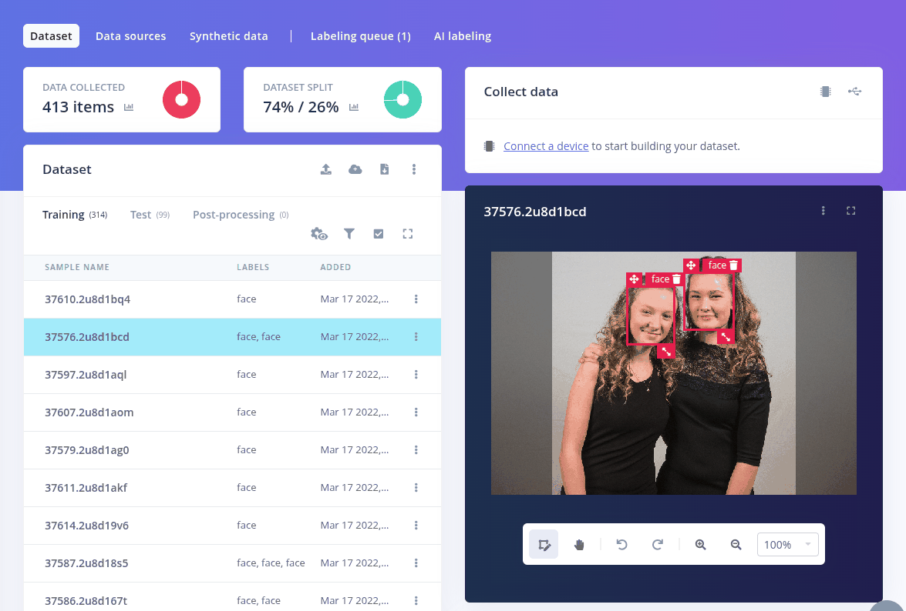
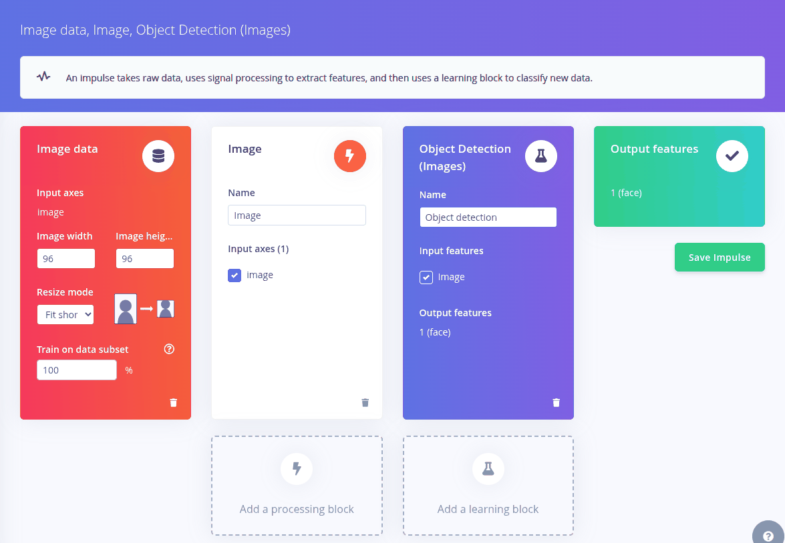
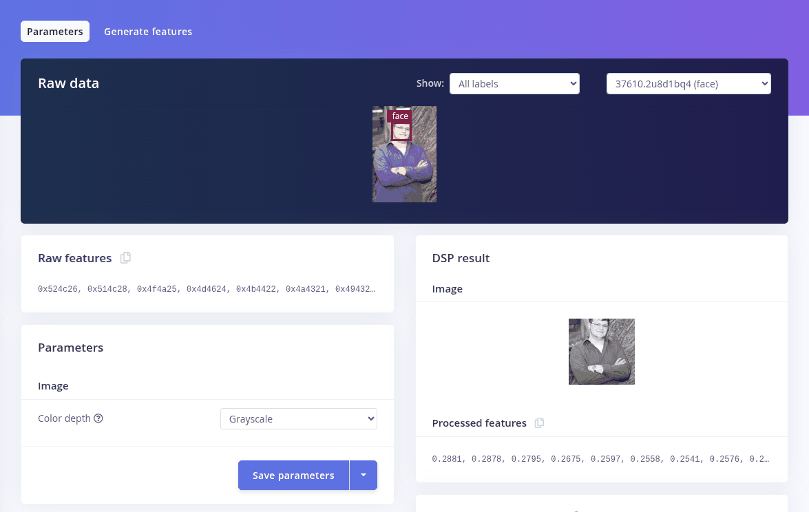
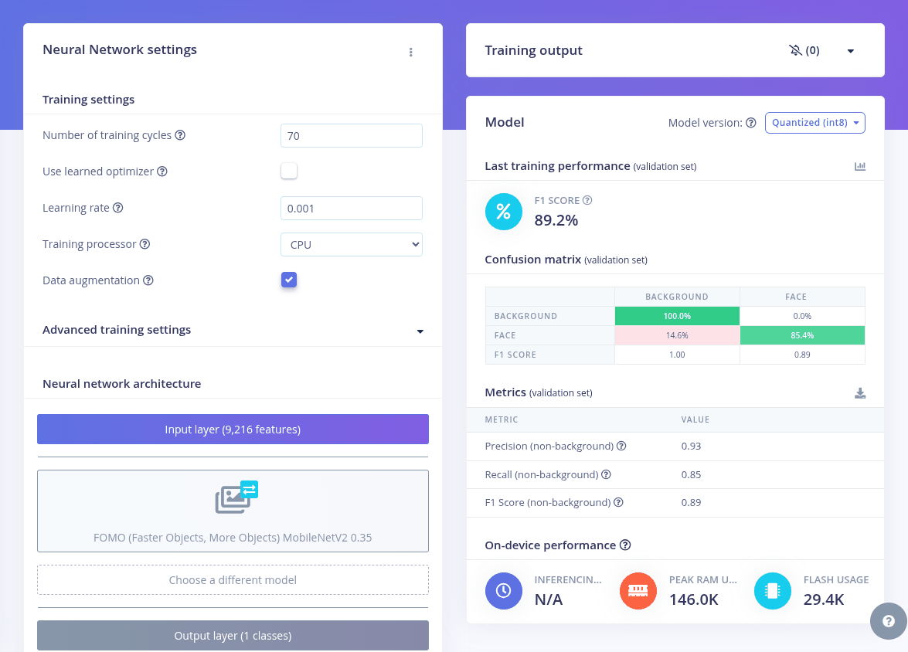
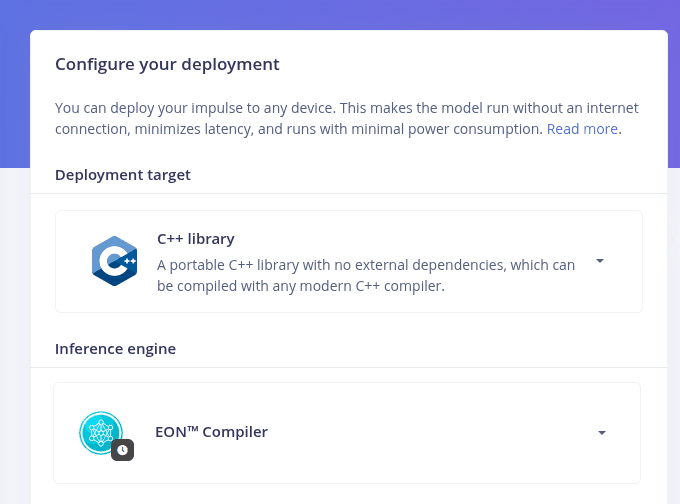

# Train your model in Edge Impulse

In about 15 minutes, with no ML code, you get your own face detection model, ready to drop into the F1 firmware.
You need a free [Edge Impulse](https://studio.edgeimpulse.com) account.

> **What is FOMO?** *Faster Objects, More Objects* is Edge Impulse's object detection model for microcontrollers.
> It doesn't draw full bounding boxes. It finds the *centre* of each object on a coarse grid, which makes it
> tiny (30 KB here) and fast enough for the ESP32-S3.

## 1. Start from the public face project

Open the public project [Face detection - FOMO](https://studio.edgeimpulse.com/public/87291/latest) and click
**Clone this project**. You get a private copy with about 400 photos where every face is already labelled.

*Data acquisition: 413 photos, split 74% for training and 26% for testing. Each red box is a labelled `face`.*

## 2. Design the impulse

An *impulse* is the pipeline from raw data to prediction. Open **Create impulse** and check that it has:

| Block | Setting | Why |
|---|---|---|
| Image data | 96 x 96, *Fit shortest axis* | Small input for a fast model. The F1 crops the camera image the same way. |
| Processing block | **Image** | Normalises the pixels |
| Learning block | **Object Detection (Images)** | FOMO |

## 3. Switch the image block to grayscale

Open **Image**, set **Color depth** to **Grayscale**, click **Save parameters**, then **Generate features**.
Grayscale needs a third of the memory and computation of colour, and faces are easy to recognise without colour.
The F1 firmware converts every camera frame to grayscale to match.

## 4. Train

Open **Object detection** and use these settings:

- Training cycles: **70**
- Learning rate: **0.001**
- Data augmentation: **on** (random flips and crops make the model more robust)
- Model: **FOMO MobileNetV2 0.35**

Click **Save & train**. On the free CPU trainer this takes about 5 minutes.

*Our result: F1 score 89% (precision 0.93, recall 0.85). The int8 model needs 146 KB RAM and 29 KB flash.*

## 5. Export as a C++ library

Open **Deployment** and choose:

- **C++ library** (plain C++, builds with ESP-IDF)
- **EON Compiler** (compiles the model to C++ code, which saves RAM and flash)
- **Quantized (int8)** (4 times smaller than float32 and uses the ESP32-S3's fast integer kernels)

Click **Build**. Your browser downloads a `.zip`.

Next: [put the model on the F1](deploy-to-f1.md).

## Make it better

- **Teach it what is *not* a face.** The public dataset is only faces, so in our self-test the model
  takes the shiny spoon in a coffee photo for a face (score 0.90). Add 50 to 100 photos of empty rooms, desks and
  objects with **no** boxes in **Data acquisition**, then retrain. The easiest way: point the F1 at an empty room
  and use **Collect training images** on its [preview page](deploy-to-f1.md#7-collect-training-images).
- **Train on your own scene.** Photos from the F1's own webcam, where it will hang, in its lighting, help more than
  anything else. The preview page exports them with the F1's face boxes already filled in.
- **Ship it without a cable.** After retraining, build and [upload the new firmware from the preview page](deploy-to-f1.md#8-update-the-firmware-over-wi-fi).
- **Check speed before you flash.** **Live classification** and **Model testing** show results on the test set in the browser.
